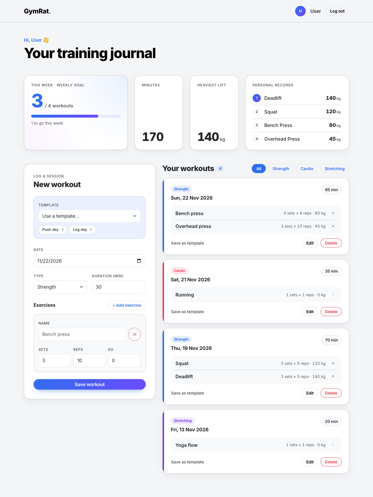
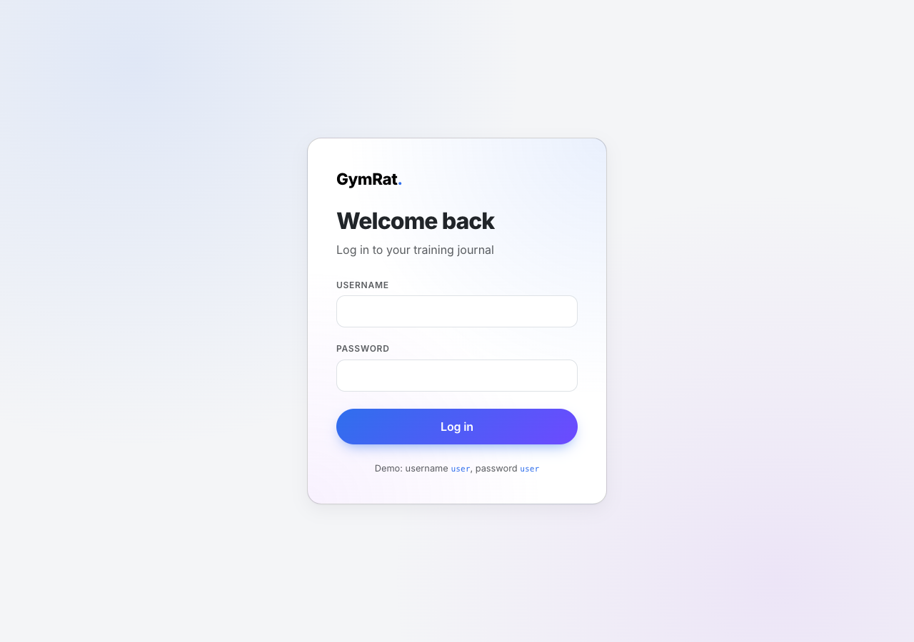
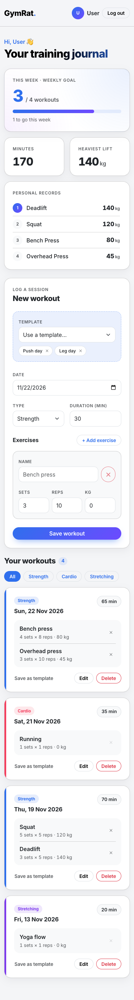

# GymRat

A training journal with user login. Each user logs workouts with exercises, edits them directly in the list, filters them by type and follows their progress through weekly statistics, a weekly goal and personal records.

Built as an assignment in the ITMentorstva frontend program and part of my [portfolio](https://github.com/adelhokulic/cv-portfolio).



<p align="center">
  
  &nbsp;
  
</p>

## Features

- **Login** with credentials checked against a JSON file (fake database). The logged-in user stays logged in after a page refresh.
- **Guests see only the login page.**
- **New workout form**: date, type (strength, cardio, stretching), duration in minutes, and a dynamic list of exercises (name, sets, reps, weight), with validation.
- **Inline editing**: clicking **Edit** turns a workout card into a pre-filled form. **Save** updates the workout and **Cancel** discards the changes.
- **Deleting** a whole workout or a single exercise. The last exercise in a workout can't be removed.
- **Filter by type**: All, Strength, Cardio, Stretching.
- **Weekly statistics** for the current week (from Monday): number of workouts, total minutes and heaviest lift.
- **Weekly goal** (4 workouts) with a progress bar.
- **Personal records**: the heaviest weight ever lifted for each exercise, sorted from heaviest. "Bench press" and "bench press " count as the same exercise.
- **Workout templates**: save any workout as a named template, fill the new workout form from it in one click, and delete templates you no longer need.
- **Per-user data**: each user sees only their own workouts and templates.
- **Persistence**: the logged-in user, workouts and templates are saved in `localStorage`.

## Design

The interface follows the design of my portfolio, so all projects look like one family:

- **React-Bootstrap** layout (`Container`, `Row`, `Col`, `Form`, `Button`, `ProgressBar`, `Alert`, `Badge`)
- **Bento dashboard**: stats, weekly goal and personal records as cards in one row, then the form and the workout list side by side
- Brand blue `#2f6fed` with a blue to violet gradient, the **Inter** font and rounded cards that lift on hover
- Translucent navbar with a blur effect
- Cards fade in one after another with a CSS `@keyframes` animation, which is turned off for users who prefer reduced motion
- Each workout type has its own color (strength blue, cardio rose, stretching violet)
- Responsive: one column on phones, two columns on large screens

## Tech stack

- React 19 + TypeScript 6
- Create React App
- React-Bootstrap 2 + Bootstrap 5.3
- React Hook Form (`useForm`, `useFieldArray`)
- Context API + `useReducer` for global state

## Getting started

```bash
npm install
npm start
```

The app runs at http://localhost:3000.

### Demo user

| Username | Password |
|---|---|
| `user` | `user` |

Users live in `src/data/users.json`. Every user only sees their own workouts and templates, so you can add another user there to try that out.

## State management

The assignment suggests **Recoil** (atoms + an atom effect for `localStorage`). This project uses **Context + `useReducer`** instead, because Recoil is no longer maintained and doesn't support React 19. The same ideas map one to one:

| Recoil (assignment) | This project |
|---|---|
| atom for the logged-in user | `AuthContext` + `authReducer` |
| atom for workouts | `WorkoutContext` + `workoutReducer` |
| atom for templates (bonus) | `TemplateContext` + `templateReducer` |
| one atom effect that saves several atoms to `localStorage` | one shared helper, `loadFromStorage` / `saveToStorage` (`src/utils/storage.ts`), used by all three contexts: lazy init in `useReducer` for reading, `useEffect` for writing |
| `useRecoilValue` / `useSetRecoilState` | custom hooks `useAuth()`, `useWorkout()` and `useTemplate()` |

**Global vs. local state**

- **Global** (context): the logged-in user, all workouts and all templates, because many components need them.
- **Local** (`useState` in a component): whether a card is in edit mode (`WorkoutCard`), the active filter (`WorkoutList`) and the login error message (`Login`), because only one component needs each of them.
- **Derived** (calculated on every render, never stored): the current user's workouts and templates, filtered workouts, the weekly statistics, goal progress and personal records.

## Project structure

```
src/
├── components/   Login, Navbar, WorkoutForm, WorkoutList, WorkoutCard, WeeklyStats, PersonalRecords
├── context/      AuthContext, WorkoutContext, TemplateContext (providers + useAuth / useWorkout / useTemplate hooks)
├── reducer/      authReducer, workoutReducer, templateReducer
├── types/        userTypes, workoutTypes, templateTypes (workout types are defined once and the TS type is derived from them)
├── utils/        storage (localStorage helper), date (start of the current week)
├── data/         users.json (fake user database)
├── index.css     design tokens and Bootstrap overrides
└── App.css       layout and component styles
```

## Notes

- **Login is not secure, by design.** Passwords live in a JSON file and are checked in the browser, as the assignment requires a fake database. A real app would check credentials on a server.
- **TypeScript 6, not 7.** TypeScript 7 no longer ships the JavaScript API that `react-scripts` needs, so CRA can't use it. The `overrides` field in `package.json` lets TypeScript 6 install alongside `react-scripts`, which officially asks for TypeScript 4.
